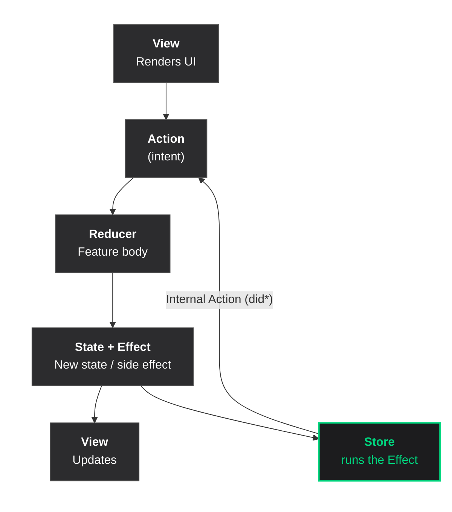

# ComposableKit — Architecture guide

> Reference guide for the architecture, the `ComposableKit` package, the scene generator (`composablekit-create.py`) and the testing skill (`/ios-tca-tests`).
> The examples come from the `POC_TCA` app (OMDb-style `Home` → `HomeDetails` scenes).

---

## 1. What is ComposableKit?

**ComposableKit** is a small, dependency-free implementation of the API of **TCA — The Composable Architecture** (Point-Free), not affiliated with or endorsed by Point-Free (see `NOTICE`): the same API and the same names (`@Reducer`, `@ObservableState`, `Effect.run`, `@Dependency`, `@Shared`, `TestStore`...), in a single Swift package that runs on **iOS 15+**.

Why use it:

- **Little boilerplate** — **5 files** per scene. `State`, `Action`, effects, reducer and analytics live in one `{SCENE}Feature.swift`.
- **Instant previews** — the View is a function of the `State`; the Preview swaps dependencies with `withDependencies`, no mock classes.
- **Predictable, testable state** — the View only reads the `State` and sends `Action`s; every rule lives in the Feature's `body`, and the `TestStore` checks every state change and every received Action.
- **Point-Free's docs apply** — the API is the same, so the TCA documentation and examples are the reference (with the adjustments listed in section 4).

### How to explain it

| Situation | Answer |
|---|---|
| Short | "It is **TCA**'s programming model — Point-Free's The Composable Architecture — in a lightweight package that supports iOS 15." |
| In a meeting | "Each screen is a Feature with state, actions and a reducer. Everything asynchronous is a declared effect and dependencies are injected, which makes everything testable with the `TestStore`. We use TCA's API in a small package with no external runtime dependency." |
| "Isn't that MVI?" | "It belongs to the same unidirectional-flow family (Redux, Elm, MVI). The idea is MVI's; the implementation is TCA's, which adds effects, dependency injection, screen composition and testing tools." |
| "Why not the official TCA?" | "Current TCA releases require iOS 16+, and our app still supports iOS 15. ComposableKit also has no external runtime dependency. Since the API is the same, Point-Free's docs apply, and moving to the official TCA once we drop iOS 15 is cheap." |

---

## 2. The pattern

**Unidirectional** data flow: the View sends an `Action`, the reducer changes the `State` and returns an `Effect`, the `Store` runs the effect and its responses come back as new `Action`s.



No arrow goes backwards. The View never mutates the state directly.

---

## 3. The components — what each one does

### Feature — "the screen's behavior"

`{SCENE}Feature` holds the screen's **behavior**: state, events and transitions. Networking, data transformation, analytics event definitions and layout live in their own files; the Store and effect execution are package infrastructure. This is what `composablekit-create.py` generates:

```swift
import ComposableKit

@Reducer
struct SafeModeFeature {

    // MARK: - State
    @ObservableState
    struct State: Equatable {
        var isLoading = false
        var viewData: SafeModeViewData?
        var errorMessage: String?
    }

    // MARK: - Action
    enum Action: Equatable {
        case viewDidAppear                   // lifecycle
        case tapContinue, tapRetry, tapClose // user
        case didLoad(SafeModeViewData)       // effect responses
        case didFail(String)
    }

    nonisolated enum CancelID { case fetch }

    // MARK: - Dependencies
    @Dependency(\.safeModeClient) var safeModeClient
    @Dependency(\.analytics) var analytics

    /// Navigation: injected by the Factory.
    nonisolated var navigate: @MainActor @Sendable (SafeModeRoute) -> Void = { _ in }

    // MARK: - Body
    var body: some ReducerOf<Self> {
        Reduce { state, action in
            switch action {
            case .viewDidAppear, .tapRetry:
                if action == .viewDidAppear, state.viewData != nil { return .none }
                state.isLoading = true
                state.errorMessage = nil
                return .run { [safeModeClient] send in
                    let response = try await safeModeClient.fetchData()
                    await send(.didLoad(SafeModeMapper.map(response)))
                } catch: { error, send in
                    await send(.didFail(error.localizedDescription))
                }
                .cancellable(id: CancelID.fetch, cancelInFlight: true)

            case let .didLoad(viewData):
                state.isLoading = false
                state.viewData = viewData
                return .none

            case let .didFail(message):
                state.isLoading = false
                state.errorMessage = message
                return .none

            case .tapContinue:
                return .run { [navigate] _ in await navigate(.nextPage) }

            case .tapClose:
                return .merge(
                    .cancel(id: CancelID.fetch),
                    .run { [navigate] _ in await navigate(.back) }
                )
            }
        }

        // Centralized analytics: one event per Action (with the already updated state).
        Reduce { state, action in
            if let event = Self.analyticsEvent(for: action, state: state) {
                analytics.track(event)
            }
            return .none
        }
    }
}
```

The `@Reducer` macro does three things: conforms the struct to `Reducer`, applies `@CasePathable` to `Action` (generating the `\.didLoad` case paths used in tests and composition) and applies `@ObservableState` to `State`.

> **Why `inout State`?** `Reduce { state, action in }` receives the state by reference: no unnecessary copy, and the code shows exactly which fields changed.

---

### The Feature is not a "god class"

Single responsibility is not "doing one thing": it is having **one reason to change**. The Feature changes when the screen's behavior changes — and everything in it changes for that reason:

| Lives in the Feature (changes when **the screen's behavior** changes) | Lives elsewhere (changes for **another** reason) |
|---|---|
| `State`: what the screen shows | Networking → `Client` + `Service` (changes when the API changes) |
| `Action`: what can happen | Transformation → `Mapper` (changes when the display rule changes) |
| `body`: how each event changes the state | Event definitions → `AnalyticsModel` (changes with the tracking spec) |
| `.run`: **declares** that data must be fetched | Layout → `View` (changes with the design) |
| `analyticsEvent(for:state:)`: which event each Action sends | Running effects, observing state → the package's `Store` (does not change per scene) |
| | Navigation destination → whoever injects `navigate` (changes with the app flow) |

It stays small because it **no longer carries the mechanics**: storing state, running and cancelling effects and notifying the View are written and tested once, in the package.

The real risk is the `body`'s `switch` growing with the screen. The criteria for splitting it are in section 12.

### State — "how the screen is right now"

```swift
@ObservableState
struct State: Equatable {
    var isLoading = false
    var viewData: SafeModeViewData?
    var errorMessage: String?
}
```

`Equatable` is required: the `TestStore` compares the expected state with the real one and shows the diff when they differ.

State is a `struct` with individual fields (not an `enum` of cases), which allows composite states (e.g. `isLoading` + `errorMessage`) and makes scene composition easier. Data coming from outside (e.g. `HomeDetails`'s `imdbID`) enters the `State` through its `init`, called by the Factory.

---

### Action — "what happened"

| Group | Examples | Who sends it |
|---|---|---|
| Lifecycle | `viewDidAppear` | View (`.task`) |
| User | `tapContinue`, `tapRetry`, `tapMovie(id:)` | View (buttons) |
| Responses | `didLoad(ViewData)`, `didFail(String)` | Effects (`send` inside `.run`) |

Action is the **scene's vocabulary**. The View does not decide what to do; it declares the event and the reducer decides.

---

### Effect — "what must happen outside the reducer"

| Effect | Use |
|---|---|
| `.none` | No effect |
| `.send(.action)` | Sends another Action right away |
| `.run { send in ... } catch: { error, send in ... }` | Asynchronous work (network, navigation); sends as many Actions as needed |
| `.merge(a, b)` / `.concatenate(a, b)` | In parallel / in sequence |
| `.cancellable(id:cancelInFlight:)` / `.cancel(id:)` | Cancellation (e.g. repeated "Try again" does not duplicate requests) |
| `.debounce(id:for:clock:)` | Search as you type |

The reducer **declares** the effect; the Store **runs** it. Unhandled errors in a `.run` without `catch:` are reported (and fail the test).

---

### Dependencies — "what comes from outside"

Each scene has a **client**: a struct of `@Sendable` closures, with `liveValue` (production) and `testValue` (fails if the test does not override it).

```swift
struct SafeModeClient: Sendable {
    var fetchData: @Sendable () async throws -> SafeModeResponse
}

extension SafeModeClient: DependencyKey {
    static let liveValue = SafeModeClient(fetchData: { try await SafeModeService().fetchData() })
    static let testValue = SafeModeClient(fetchData: { throw UnimplementedError("SafeModeClient.fetchData") })
}

extension DependencyValues {
    var safeModeClient: SafeModeClient {
        get { self[SafeModeClient.self] }
        set { self[SafeModeClient.self] = newValue }
    }
}
```

In the Feature: `@Dependency(\.safeModeClient) var safeModeClient`. In tests and in the Preview: `deps.safeModeClient.fetchData = { .fixture() }`. No service protocols, no spy classes.

The generated Service uses `URLSession` with `async/await`, so cancelling the effect (`.cancel(id:)`, `cancelInFlight`) also cancels the HTTP request:

```swift
nonisolated struct SafeModeService: Sendable {
    var baseURL = URL(string: "https://api.example.com")! // TODO: your API's base URL
    var session: URLSession = .shared

    func fetchData() async throws -> SafeModeResponse {
        let url = baseURL.appendingPathComponent("safe-mode") // TODO: the real endpoint
        let (data, response) = try await session.data(from: url)
        guard let http = response as? HTTPURLResponse, (200..<300).contains(http.statusCode) else {
            throw URLError(.badServerResponse)
        }
        return try JSONDecoder().decode(SafeModeResponse.self, from: data)
    }
}
```

If your app already has a networking layer, call it from the Service and keep the `async throws` signature.

Built into the package: `continuousClock` (injectable clock), `uuid`, `date`. The `AnalyticsClient` (`@Dependency(\.analytics)`) is defined **once per module** (section 8).

---

### Store — "the hub of the cycle"

```swift
// In the Factory:
let store = Store(initialState: SafeModeFeature.State()) {
    SafeModeFeature(navigate: navigate)
}

// In the View:
@ObservedObject var store: StoreOf<SafeModeFeature>

// Reading the state (dynamic member lookup):
store.isLoading

// Sending an Action:
store.send(.tapRetry)
await store.send(.viewDidAppear).finish() // waits for the effects to finish
```

The `Store` is an `ObservableObject` (works on iOS 15+). The View redraws when its Store's state changes; changes to an equal value are ignored. For composed scenes, `store.scope(state:action:)` creates child Stores.

---

### Route — "navigation destinations"

```swift
enum SafeModeRoute: Equatable, Sendable {
    case back
    case nextPage
}
```

The `navigate` closure is injected into the Feature by the Factory, and **whoever creates the scene decides what each Route does**:

```swift
@MainActor
enum SafeModeFactory {
    static func make(
        navigate: @escaping @MainActor @Sendable (SafeModeRoute) -> Void = { _ in }
    ) -> UIViewController {
        let store = Store(initialState: SafeModeFeature.State()) {
            SafeModeFeature(navigate: navigate)
        }
        return UIHostingController(rootView: SafeModeView(store: store))
    }
}
```

Real example from the POC (`AppRouter`): Home navigates to `.movieDetails(imdbID:)`, and the router pushes `HomeDetails`:

```swift
HomeFactory.make { [weak navigationController] route in
    switch route {
    case let .movieDetails(imdbID):
        navigationController?.pushViewController(
            HomeDetailsFactory.make(imdbID: imdbID) { route in /* .back → pop */ },
            animated: true
        )
    }
}
```

> **Why no Coordinator per scene?** The `navigate` closure gives the same decoupling without one more object per screen: the scene only emits the `Route`, and whoever creates it — the module's Coordinator/router (like the POC's `AppRouter`) — decides what to do. That Coordinator calls the Factories, which are `@MainActor`: it must be `@MainActor` too when the target does not use default `MainActor` isolation (section 4). In the scene's tests, `navigate` is a `LockIsolated<[Route]>` that collects the routes it receives.

The Factory returns a `UIViewController`, so scenes plug into UIKit navigation (`UINavigationController`, modals) or into SwiftUI through `UIViewControllerRepresentable` (as the POC's `RootNavigationView` does).

---

### View — "a mirror of the state"

```swift
struct SafeModeView: View {
    @ObservedObject var store: StoreOf<SafeModeFeature>

    var body: some View {
        Group {
            if let viewData = store.viewData {
                contentView(viewData: viewData)
            } else if store.isLoading {
                ProgressView()
            } else if let errorMessage = store.errorMessage {
                errorView(message: errorMessage)
            } else {
                ProgressView() // idle
            }
        }
        .task { await store.send(.viewDidAppear).finish() }
    }
}
```

The View does two things and only two: it **reads** the state and **sends** Actions. Form fields use `$store.field` (with `BindableAction` + `BindingReducer`), so even typing goes through the reducer. The generated View uses only native SwiftUI components (`Button` with `.borderedProminent`/`.bordered`, `Image(systemName:)`, system fonts); swap them for your design system's components freely, as long as the "View contract" (section 9) holds.

---

## 4. The ComposableKit package

A single product (`ComposableKit`, iOS 15+, built in Swift 6 mode) plus the macro plugin. No runtime dependencies (`swift-syntax` is only used to compile the macros).

Add it as a local or remote Swift package and link the `ComposableKit` product to the **app target only**. The app's test target just does `import ComposableKit` (linking it again would load two copies of the library).

### Compatibility

| Item | Supported |
|---|---|
| Deployment target | **iOS 15+** (package and generated scenes) |
| App language mode | **Swift 5** and Swift 6 (the package itself builds in Swift 6, regardless of the app) |
| Target default isolation | **No** default isolation (older projects) and **default `MainActor`** + Approachable Concurrency (new Xcode 26 projects), test target included |
| Compiler | **Xcode 26+** (Swift 6.2). The package uses `nonisolated(nonsending)` (Swift 6.2) and the scene template uses `nonisolated` on types (Swift 6.1); no Swift 6.3+ feature is used |
| Tests | Swift Testing (Xcode 16+). `.timeLimit` requires iOS 16: the testing skill omits it on lower deployment targets |

```
ComposableKit/
├── Package.swift
├── Sources/ComposableKit/
│   ├── Reducer.swift        ← Reducer protocol, Reduce, @ReducerBuilder, CombineReducers
│   ├── Effect.swift         ← Effect<Action>: none, send, run, merge, concatenate, cancel, debounce
│   ├── Store.swift          ← Store / StoreOf (ObservableObject), scope
│   ├── Scope.swift          ← Scope, .ifLet, .forEach
│   ├── IdentifiedArray.swift← IdentifiedArrayOf
│   ├── Binding.swift        ← BindableAction, BindingReducer, $store.field
│   ├── Dependencies.swift   ← @Dependency, DependencyKey, withDependencies, clock/uuid/date
│   ├── Shared.swift         ← @Shared(.inMemory / .appStorage / .fileStorage)
│   ├── CasePaths.swift      ← case paths (\.didLoad)
│   ├── Macros.swift         ← @Reducer, @ObservableState, @CasePathable
│   ├── ReducerModifiers.swift ← .onChange(of:), .dependency(_:_:), ._printChanges()
│   ├── TestStore.swift      ← exhaustive TestStore, receive, finish
│   ├── TestClock.swift      ← test-controlled clock
│   ├── LockIsolated.swift   ← capturing values in @Sendable closures
│   └── ...                  ← RootCore, Diff, IssueReporting, Internal
├── Sources/ComposableKitMacros/  ← macro implementations
└── Tests/                        ← 179 tests + 6 macro tests
```

### Equivalence with TCA

| TCA (Point-Free) | ComposableKit |
|---|---|
| `@Reducer`, `@ObservableState`, `@CasePathable` | Same |
| `Effect.run`, `.cancellable`, `.debounce` | Same |
| `@Dependency`, `DependencyKey`, `withDependencies` | Same |
| `@Shared`, `Scope`, `.ifLet`, `.forEach` | Same |
| `TestStore`, `receive(\.case)`, `exhaustivity` | Same |
| Observation with `@Observable` / Perception | `ObservableObject` (iOS 15+): redraws per screen, not field by field |
| `continuousClock: any Clock` | `EffectClock` (`TestClock`, `ImmediateClock`) |

### Differences when copying Point-Free examples

The API is the same, but not identical. Examples from the current TCA docs need these adjustments:

| In the TCA example | In ComposableKit |
|---|---|
| `let store: StoreOf<X>` or `@Bindable var store` in the View | `@ObservedObject var store: StoreOf<X>` (`$store.field` works the same) |
| `WithPerceptionTracking { ... }` | Does not exist and is not needed (`ObservableObject`) |
| `@Presents var destination` + `PresentationAction` | Does not exist: modals and pushed screens are navigation via `Route` + `navigate` (Coordinator/router). For a child inside the same screen, `.ifLet` with optional state |
| `StackState` / `NavigationStack(path:)` | Does not exist: the stack belongs to the Coordinator's `UINavigationController` |
| `ifCaseLet` | Does not exist: use `.ifLet` with optional state |
| `.onChange(of:)`, `.dependency(_:_:)` and `._printChanges()` on the reducer | **Same** (section 13) |
| `@DependencyClient` | Does not exist: write the client with `liveValue`/`testValue` (the script generates it) |
| `@Dependency(\.continuousClock)` as `any Clock<Duration>` | `any EffectClock`, with `sleep(for: Double)` in seconds |

Cancellation ids: same as TCA, isolated per `.ifLet` child and per `.forEach` element; `Scope` shares the parent's namespace.

### TCA on every screen?

Architecture guides recommend not using TCA on trivial screens: the ceremony does not pay off. With ComposableKit the ceremony goes to the generator, so using it **on every scene** is a reasonable team rule:

- **Uniformity across teams and modules:** every scene has the same 5 files and the same cycle; whoever opens another team's module already knows where everything is.
- **The cost moved to the tools:** the script creates the scene offline and the testing skill writes the tests; on a simple screen, only the Response, Mapper and View TODOs remain.
- **The same tests for everything:** the `TestStore` gives the same level of verification (state, effects, navigation, analytics) on a screen with one Action or twenty.

What **not** to use on a simple scene: composition (`Scope`, `.ifLet`, `.forEach`), `@Shared` and child Features. They come in when the screen calls for them (section 12), not by default.

### Rules for apps with default `MainActor` isolation

New Xcode 26 projects use `SWIFT_DEFAULT_ACTOR_ISOLATION = MainActor`. In those targets, some declarations need `nonisolated` — **the script already generates them that way**:

| Declaration | Without `nonisolated` |
|---|---|
| `nonisolated enum CancelID` | Does not compile (`cancellable(id:)` requires `Hashable & Sendable` outside the MainActor) |
| `nonisolated var navigate: @MainActor @Sendable (Route) -> Void` | **Crash when navigating**: the compiler drops the closure's `@MainActor` when capturing it in `.run` and the next Store is created off the main thread |
| `nonisolated struct {SCENE}Response` / `{SCENE}Service` | Warnings (errors in Swift 6): `Decodable`, the network call and the fixtures run outside the MainActor |
| `nonisolated protocol AnalyticsEvent` | Events are created and read outside the MainActor |

The template compiles in both language modes (Swift 5 and Swift 6): moving to Swift 6 will not require touching the scenes.

The `navigateShouldRunOnMainThread` test (generated by the testing skill) catches the `navigate` regression.

**Target without default `MainActor` isolation** (older projects, Swift 5): the Factories are `@MainActor`, so **the Coordinator/router that calls them must be `@MainActor` too** (`@MainActor final class XCoordinator` or `@MainActor enum AppRouter`). Otherwise: `call to main actor-isolated static method 'make(...)' in a synchronous nonisolated context`.

---

## 5. ComposableKit vs MVVM — the biggest difference

With MVVM in SwiftUI, the View reads **and writes** the ViewModel:

```swift
viewModel.isLoading = false  // possible with MVVM
viewModel.fetchData()        // the View calls the procedure
```

With ComposableKit, **the View never touches the state**:

```swift
store.send(.tapRetry)  // the View declares the event
// the reducer decides: .tapRetry → isLoading = true, .run { fetch }
```

| MVVM | ComposableKit | Key difference |
|---|---|---|
| `ViewModel` | `StoreOf<Feature>` | The Store exposes no setters — it receives Actions |
| `@Published var isLoading`, `items`... | `State` | A single value represents the whole state |
| `viewModel.fetchData()` | `store.send(.tapRetry)` | An event, not a procedure |
| Binding `$viewModel.text` | `$store.text` (BindingReducer) | The write goes through the reducer and is testable |

---

## 6. ComposableKit vs VIP

| | VIP | ComposableKit |
|---|---|---|
| **Flow** | View → Interactor → Presenter → View | View → Action → Reducer → State → View |
| **State** | Spread across Interactor + Presenter + View | Centralized: a single `State` |
| **Testability** | Presenter and Interactor mocks | `TestStore` + overridden dependencies, no class mocks |
| **Navigation** | Router called by the Interactor | `navigate` closure, injected by the Factory |
| **Boilerplate** | A protocol per layer | No protocols between Feature/Store/View |
| **SwiftUI** | Needs a bridge | Native — the Store is an `ObservableObject` |

| VIP | ComposableKit |
|---|---|
| `Interactor` | `Store` (orchestration) + the Feature's `body` (logic) |
| `Presenter` / `ViewModel` | `ViewData` produced by the `Mapper` |
| `Router` | `navigate` closure |
| `Worker` | `Service`, accessed through the `Client` |

---

## 7. Getting started

1. Add the `ComposableKit` package to the project and link the product to the app target (section 4).
2. Create a scene:

   ```bash
   python3 composablekit-create.py SafeMode ./MyApp/Scenes
   ```

   The script works offline. It creates the 5 scene files and — if the module has none yet — `Shared/Analytics/AnalyticsClient.swift` next to the scenes folder.
3. Implement the TODOs (section 9, "After the script").
4. When the feature is done, run `/ios-tca-tests SafeMode` (Claude Code skill) to generate its tests, including the test target helpers (`ComposableKitTestSupport.swift`, `NSError+Fixture.swift`) when they are missing.
5. Wire the Factory into your Coordinator/router (section 3, Route).

---

## 8. Analytics

Analytics lives in the Feature, in two parts:

1. **`static func analyticsEvent(for:state:)`** — a pure function that says which event each Action sends (easy to test case by case). `state` is the state **after** the Action.
2. **A second `Reduce` in `body`** — calls `analytics.track(event)` for every Action, passing the updated state.

```swift
static func analyticsEvent(for action: Action, state: State) -> (any AnalyticsEvent)? {
    switch action {
    case .didLoad:
        SafeModeAnalyticsModel.ScreenViewEvent()
    case .tapContinue:
        SafeModeAnalyticsModel.SelectContentEvent(item: .tapContinue)
    case .tapClose:
        SafeModeAnalyticsModel.SelectContentEvent(item: .tapClose)
    case let .didFail(message):
        SafeModeAnalyticsModel.AlertEvent(message: message)
    case .viewDidAppear, .tapRetry:
        nil
    }
}
```

Each scene declares its events in `{SCENE}AnalyticsModel`. An event is just a name plus parameters:

```swift
enum SafeModeAnalyticsModel {
    struct ScreenViewEvent: AnalyticsEvent {
        let name = "screen_view"
        var parameters: [String: String] { ["screen_name": "safe-mode"] }
    }

    struct SelectContentEvent: AnalyticsEvent {
        let name = "select_content"
        let item: Item
        var parameters: [String: String] { ["screen_name": "safe-mode", "item": item.rawValue] }

        enum Item: String {
            case tapContinue = "continue"
            case tapClose = "close"
        }
    }
}
```

The Feature uses `@Dependency(\.analytics)`. The client exists **once per module** (or in a shared module; the Feature does not compile without it). The script creates it when it is missing:

```swift
nonisolated protocol AnalyticsEvent {
    var name: String { get }
    var parameters: [String: String] { get }
}

struct AnalyticsClient: Sendable {
    var track: @Sendable (any AnalyticsEvent) -> Void
}

extension AnalyticsClient: DependencyKey {
    static let liveValue = AnalyticsClient { event in
        // TODO: forward to your analytics SDK (Firebase, Amplitude, ...).
        print("[Analytics] \(event.name) \(event.parameters)")
    }
    static let testValue = AnalyticsClient { _ in } // tests override it to capture events
}

extension DependencyValues {
    var analytics: AnalyticsClient {
        get { self[AnalyticsClient.self] }
        set { self[AnalyticsClient.self] = newValue }
    }
}
```

**Analytics with screen data:** when an event carries data (the displayed id, the tapped item), add a property to the event (`let itemID: String`, or `var itemID: String? = nil` when only some actions have it), include it in `parameters` and fill it from the `state` or the Action's payload: `ScreenViewEvent(itemID: state.itemID)`. If the event must only be sent when the action has an effect (e.g. navigate only if there is a code), extract the condition into a `private static func` used by `body` **and** by `analyticsEvent`:

```swift
// Feature: the same rule decides navigation and the event
private static func canSelectSlot(_ state: State) -> Bool {
    state.viewData?.isPending == true
}

// body
case let .tapSlot(id):
    guard Self.canSelectSlot(state) else { return .none }
    return .run { [navigate, policyID = state.policyID] _ in
        await navigate(.confirmSlot(policyID: policyID, slotID: id))
    }

// analyticsEvent(for:state:)
case let .tapSlot(id):
    Self.canSelectSlot(state)
        ? SceneAnalyticsModel.SelectContentEvent(item: .tapSlot, slotID: id)
        : nil
```

Tests: each branch on both sides — in the reducer (navigates / does not navigate) and in `analyticsEvent` (event / `nil`).

**When `ScreenViewEvent` is sent:** only on the screen's **first appearance**, when the content loads (`didLoad`). When coming back from a pushed screen (Details → Home), the View's `.task` sends `viewDidAppear` again, but the Feature does not reload when it already has content; without `didLoad`, there is no new screen view. The exception is a "Try again" that succeeds: it reloads and sends a new `ScreenViewEvent`. If your tracking needs one screen view per appearance, move the event from `didLoad` to `viewDidAppear` in `analyticsEvent(for:state:)`.

Tracking is **synchronous** (not an effect): it does not require `Sendable` events or leave pending effects in tests. When the event needs screen data, it comes from the `state` — e.g. in `HomeDetails`, `ScreenViewEvent(movieID: state.imdbID)`.

---

## 9. Scene folder structure

```
SceneName/
├── Core/
│   └── SceneNameFeature.swift        ← State + Action + body + Route + analytics
├── UI/
│   └── SceneNameView.swift           ← SwiftUI View + Factory + Preview
└── Service/
    ├── SceneNameService.swift         ← Response + Client (dependency) + Service (network)
    ├── SceneNameMapper.swift          ← Response → ViewData
    └── SceneNameAnalyticsModel.swift
```

These are the **5 files** generated by `python3 composablekit-create.py SceneName <folder>` (offline). If the scene already exists, the script only creates the missing files and never overwrites implemented code; to reset the scene to the template, pass `--force`. The script does not create tests (section 11).

### After the script: what to implement

The script prints the TODOs. In order:

| File | What to change |
|---|---|
| `{Scene}Service` | `{Scene}Response` with the real fields (nested types — `enum Status`, `struct Item` — inherit the Response's `nonisolated`), the base URL and endpoint, and the HTTP method (or a call into your networking layer). New endpoint = new closure in `{Scene}Client` |
| `{Scene}Mapper` | `Response` → `ViewData`: every formatting and display rule lives here |
| `{Scene}Feature` | `ViewData` fields; the scene's Actions and Routes — **remove** the template ones it does not use (`tapContinue`/`.nextPage`, `tapClose`/`.back`), with their `case` in `body`, in `analyticsEvent`, in the analytics `Item` enum **and the button in the View** ("Continue" sends `.tapContinue`) |
| `{Scene}AnalyticsModel` | Event names and parameters from your tracking spec (the template values are placeholders marked with `TODO`) and dynamic properties (section 8) |
| `{Scene}View` | Placeholder: replace it with the real layout, keeping the "View contract" below |
| `{Scene}Factory.make` | Parameters the scene receives from outside and the Coordinator/router's `navigate` closure |

Then, with the feature done: `/ios-tca-tests {Scene}` to generate its tests from the real code.

#### Endpoint with a parameter (data coming from outside)

When the scene receives data (the item's id), it comes in through the Factory, stays in the `State` and goes to the client. Rename `fetchData` to the resource name in the Client **and** in the Service, and replace **every `State()`** of the template (Factory and `#Preview`). In the `#Preview`, also replace the client override (`deps.sceneClient.fetchData = { SceneResponse() }`): the endpoint name changed and, once the `Response` has fields, `SceneResponse()` without arguments stops compiling — return a complete sample `Response` (the same as the API JSON):

```swift
// State
struct State: Equatable {
    let itemID: String
    // ...
    init(itemID: String) { self.itemID = itemID }
}

// Client
var fetchItem: @Sendable (_ id: String) async throws -> SceneResponse
static let liveValue = SceneClient(fetchItem: { id in try await SceneService().fetchItem(id: id) })
static let testValue = SceneClient(fetchItem: { _ in throw UnimplementedError("SceneClient.fetchItem") })

// Feature: capture the State value in .run
return .run { [sceneClient, itemID = state.itemID] send in
    let response = try await sceneClient.fetchItem(itemID)
    await send(.didLoad(SceneMapper.map(response)))
} catch: { error, send in
    await send(.didFail(error.localizedDescription))
}
.cancellable(id: CancelID.fetch, cancelInFlight: true)

// Factory: the data comes before navigate
static func make(
    itemID: String,
    navigate: @escaping @MainActor @Sendable (SceneRoute) -> Void = { _ in }
) -> UIViewController {
    let store = Store(initialState: SceneFeature.State(itemID: itemID)) {
        SceneFeature(navigate: navigate)
    }
    return UIHostingController(rootView: SceneView(store: store))
}
```

#### An enum the backend may extend

If the backend may send a new value (status, type), the screen must not break: decode with a fallback case instead of a raw `String`:

```swift
enum Status: Decodable, Equatable, Sendable {
    case active, blocked, closed
    case unknown(String) // a value the app does not know yet

    init(from decoder: Decoder) throws {
        let value = try decoder.singleValueContainer().decode(String.self)
        switch value {
        case "active": self = .active
        case "blocked": self = .blocked
        case "closed": self = .closed
        default: self = .unknown(value)
        }
    }
}
```

The Mapper gives `.unknown` a text (e.g. "Status unavailable"). Tests: in `ResponseTests`, each API value → the right case and an unknown value → `.unknown("...")`; in `MapperTests`, one test per case, `.unknown` included. A **closed** enum (the contract guarantees the values) can keep using `rawValue`: an unknown value makes decoding fail.

#### Currency and numbers

Format in the Mapper, with a single formatter for the module, never in the View. Watch out: `NumberFormatter`/`FormatStyle` output depends on the locale, and some locales separate the currency symbol from the value with a **non-breaking space** (U+00A0, e.g. `pt_BR`: `"R$\u{00A0}12,50"`); in tests, compare with a literal produced by the same formatter or write the escape explicitly, and pin the locale. Required edge-case tests (testing skill): zero, cents < 10, thousands, negative.

#### Cancelling the fetch when leaving the screen

An Action that leaves the screen (`tapClose`, `tapBack`) cancels the in-flight fetch — the template already does it in `tapClose`:

```swift
case .tapClose:
    return .merge(
        .cancel(id: CancelID.fetch),
        .run { [navigate] _ in await navigate(.back) }
    )
```

There is no need to reset `isLoading`: the screen is leaving. With the generated `URLSession` Service, cancelling the effect also cancels the HTTP request.

#### View contract

The generated View is a **placeholder**. It may have any layout and components (native or from your design system), as long as it keeps:

| Rule | Why |
|---|---|
| Name `{Scene}View` and `@ObservedObject var store: StoreOf<{Scene}Feature>` | The Factory creates the View with `{Scene}View(store:)` |
| `.task { await store.send(.viewDidAppear).finish() }` | Starts loading. `.task` runs **on every appearance**; the Feature ignores `viewDidAppear` when it already has `viewData` |
| Handles `viewData`, `isLoading` and `errorMessage`, **checking `viewData` before `isLoading`**; with `viewData` **and** `errorMessage`, it shows the error as a warning above the content | During "Try again", the loaded content stays visible; if the new attempt fails, the user sees the error (without the warning, the failure would be silent) |
| Close/back (`tapClose`) **outside** the content, always visible | The user can leave while loading and on error too — and `tapClose` cancels the in-flight fetch |
| Form fields via `$store.field` (`BindableAction` + `BindingReducer`) | The value goes through the reducer and is testable |
| Every interaction via `store.send(.action)`; no rules in the View | The View has no unit tests: logic in it is not covered |
| Every `tap*` wired to an element on screen | No test checks that wiring: review it when replacing the View |
| `#Preview` overrides **every** client endpoint and `analytics` | In the Preview, a non-overridden dependency uses its `liveValue` (as in TCA) and calls the real Service |

#### When to split the Feature

| Signal | What to do |
|---|---|
| More than ~10–12 Actions, or a `body` longer than ~150 lines | Child Features (`Scope`, `.ifLet`, `.forEach`) — section 12 |
| A block of the screen with its own lifecycle (a card that loads by itself, a form, an interactive list) | A child Feature from the start |
| A large `analyticsEvent(for:state:)` | An extension in `{Scene}Feature+Analytics.swift` |
| Business rules inside `.run` | Move them to the Client/Service or to the Mapper: `.run` only calls the client, goes through the Mapper and sends the Action |
| The same computation in `body` and in `analyticsEvent` | A `private static func` used by both |

Other template rules: the Mapper is called **inside** `await send(...)` in `.run` (it also compiles with default `MainActor` isolation); inside `.run`, `await send(.action, animation: .default)` animates the change.

---

## 10. Full flow — step by step

**The screen appears (loading):**

1. The View runs `await store.send(.viewDidAppear).finish()` in `.task` (which runs on every appearance: when coming back from a pushed screen, the Feature sees it already has `viewData` and does not reload)
2. The reducer sets `isLoading = true` and returns `.run { ... }.cancellable(id: CancelID.fetch)`
3. **The View redraws and shows `ProgressView()`**
4. The Store runs the effect: `safeModeClient.fetchData()` → `SafeModeService` → network
5. Success: the effect does `await send(.didLoad(SafeModeMapper.map(response)))`
6. The reducer sets `isLoading = false` and `viewData`; the second `Reduce` tracks the `ScreenViewEvent`
7. **The View redraws and shows the content**

If step 4 fails, `catch:` sends `.didFail(message)` → `errorMessage` → **the View shows "Try again"** → `AlertEvent`.

**The user taps "Continue" (navigation):**

1. The View calls `store.send(.tapContinue)`
2. The second `Reduce` tracks the `SelectContentEvent`
3. The reducer returns `.run { [navigate] _ in await navigate(.nextPage) }`
4. The `navigate` closure runs on the main thread (it is `@MainActor`) and the Factory's caller does the `pushViewController`

---

## 11. Tests

Tests are generated by the `/ios-tca-tests` skill (Claude Code), **after** the feature is implemented: it reads the scene's real code, writes the tests, runs them and iterates until they are green. It is independent of the scene generator: it works on any scene that follows the ComposableKit pattern. There are **4 files per scene**, one per production responsibility, all without `sleep` and without spy classes:

```
{Target}Tests/
├── Helpers/                          ← once per target
│   ├── ComposableKitTestSupport.swift ← routes TestStore failures to Swift Testing and isolates @Shared per test
│   └── NSError+Fixture.swift
└── SceneName/
    ├── SceneNameFeatureTests.swift   ← @Suite Reducer · Analytics · Factory
    ├── SceneNameMapperTests.swift    ← Response → ViewData
    ├── SceneNameResponseTests.swift  ← API JSON → Response
    └── Helpers/Fixture+SceneName.swift
```

> Without `ComposableKitTestSupport.swift` (class `ComposableKitTestSupport`), `TestStore` failures only show up in the console and **the test passes**. It also gives each test its own `@Shared` values (`currentTestScope` method): with an old version of the file, `@Shared` values leak between tests — replace it with the skill's template.
>
> The `Response` fixtures and `NSError.fixture` are `nonisolated static func`: they run inside the clients' `@Sendable` closures. Without it, in a test target with default `MainActor` isolation, there is a warning in Swift 5 (an error in Swift 6).

### One suite per responsibility

| Production file | Test suite | What it guarantees | How |
|---|---|---|---|
| The Feature's `body` | `FeatureTests` › `Reducer` | Each Action → state and received Actions, in order; cancellation; each `tap*` delivers the right Route, **on the main thread** | `TestStore` + overridden client, `TestClock`, `LockIsolated<[Route]>` |
| `analyticsEvent(for:state:)` | `FeatureTests` › `Analytics` | The right event per Action + one integration test | `deps.analytics.track` |
| `Factory` (View file) | `FeatureTests` › `Factory` | Returned type (`UIHostingController<SceneView>`), initial state, `navigate` wired | Real `Store` |
| `Mapper` | `MapperTests` | `Response` → `ViewData`, field by field, edge cases | Literal values |
| `Response` (Service file) | `ResponseTests` | The API JSON decodes (`CodingKeys`, required, optional) | Literal JSON with the **API's** keys |
| `View`, `Service` type | — | No logic / depend on the network | — |

Whoever implements `navigate` (the module's Coordinator; in the POC, `AppRouter`) has its own tests: they check that each Route pushes or pops the right screen.

### What a test looks like

```swift
@Test
func viewDidAppearWhenServiceSucceedsShouldShowViewData() async {
    let store = TestStore(initialState: SafeModeFeature.State()) {
        SafeModeFeature()
    } withDependencies: { deps in
        deps.safeModeClient.fetchData = { .fixture() }
    }

    await store.send(.viewDidAppear) { state in
        state.isLoading = true               // expected state after the Action
    }
    await store.receive(\.didLoad, .fixture()) { state in  // Action the effect sent
        state.isLoading = false
        state.viewData = .fixture()
    }
}
```

The `TestStore` is **exhaustive**: it fails if the state changes without being declared, if a received Action is not checked or if the test finishes with effects in flight.

### Rules that avoid coupling

- **Fixture contract:** `ViewData.fixture()` is exactly what the Mapper produces from `Response.fixture()`. The Feature tests use `.fixture()` on both sides and **do not call the Mapper**; a single test in `MapperTests` enforces the contract. So a Mapper bug fails only `MapperTests`.
- **API JSON, not `CodingKeys`:** `ResponseTests` uses the keys from the contract/OpenAPI/a real response. Copying them from the `CodingKeys` would make the test confirm the mistake instead of catching it.
- **Dependencies through abstraction:** the test overrides only the client endpoint the flow uses; the `testValue` fails loudly if anything else is called.

---

## 12. Complex scenes — splitting into child Features

In large server-driven scenes (the backend decides which components exist), **do not grow the root Feature**: split it into child Features and compose them with the package's tools.

```swift
@Reducer
struct InvestHomeFeature {
    @ObservableState
    struct State: Equatable {
        var balance = InvestHomeBalanceFeature.State()
        var advisor: InvestHomeAdvisorFeature.State?          // only shows up sometimes
        var cards: IdentifiedArrayOf<InvestCardFeature.State> = []
    }
    enum Action: Equatable {
        case balance(InvestHomeBalanceFeature.Action)
        case advisor(InvestHomeAdvisorFeature.Action)
        case cards(IdentifiedAction<String, InvestCardFeature.Action>)
    }
    var body: some ReducerOf<Self> {
        Scope(state: \.balance, action: \.balance) { InvestHomeBalanceFeature() }
        Reduce { state, action in /* the shell's logic */ .none }
            .ifLet(\.advisor, action: \.advisor) { InvestHomeAdvisorFeature() }
            .forEach(\.cards, action: \.cards) { InvestCardFeature() }
    }
}
```

In the View: `InvestHomeBalanceView(store: store.scope(state: \.balance, action: \.balance))`. Each child has its own lifecycle, client and tests. The effects of an `.ifLet` child are cancelled when it leaves the state. The cancellation ids of each `.ifLet` child and each `.forEach` element are isolated (as in TCA): two rows with `CancelID.fetch` do not cancel each other's requests.

**Navigation:** the `navigate` closure is injected by the root Factory and passed down to the children that navigate.

### Large lists: one Store per row

The `Store` is an `ObservableObject`: the View observing it redraws when **any** field of its state changes. In a list with many rows, do not pass loose data from one Store to each row; give each row **its own Store**:

```swift
// Parent Feature
var rows: IdentifiedArrayOf<RowFeature.State> = []
case rows(IdentifiedActionOf<RowFeature>)
// body: .forEach(\.rows, action: \.rows) { RowFeature() }

// Parent View: light, only builds the list
ForEach(store.scope(state: \.rows, action: \.rows)) { rowStore in
    RowView(store: rowStore) // @ObservedObject var store: StoreOf<RowFeature>
}
```

Changing a row notifies **only that row's Store** (test `forEachScopedStoresNotifyOnlyTheChangedRow` in the package); the other rows' Stores do not fire `objectWillChange`. The parent Store is notified too (the array changed), so the parent View's `body` runs again: keep it light (just the `ForEach`), with no formatting or computation, which belong in the Mapper or the row's state.

---

## 13. Shared state, forms and time

```swift
// State shared between scenes
@Shared(.appStorage("acceptedTerms")) var acceptedTerms = false
state.$acceptedTerms.withLock { $0 = true }
// When a @Shared changes, only the screens whose state contains it redraw.
// .fileStorage writes on a background queue (several changes in a row = one write)
// and flushes pending writes immediately when the app goes to the background or terminates.
// Tests: each test has its own values; .appStorage/.fileStorage stay in memory only.

// Form
enum Action: BindableAction { case binding(BindingAction<State>) /* ... */ }
var body: some ReducerOf<Self> { BindingReducer(); Reduce { ... } }
TextField("Email", text: $store.email)          // in the View

// Search as you type
return .run { ... }.debounce(id: CancelID.search, for: 0.3, clock: continuousClock)
```

### Reducer modifiers (same as TCA, iOS 15+)

**`.onChange(of:)`** — reacts when a state field changes, even without a dedicated Action (the typical case is `BindingReducer`, where the field changes through the binding):

```swift
BindingReducer()
    .onChange(of: \.email) { oldValue, newValue in
        Reduce { state, _ in
            state.isValid = newValue.contains("@")
            return .none
        }
    }
```

The reaction runs after the reducer, with the same Action, only when the value changes (`==`), and its effects are merged with the reducer's. The same value again: nothing happens.

**`.dependency(_:_:)`** — overrides a dependency only for a child Feature, including inside the effects it creates (a `@Dependency` read inside `.run` also sees the override); siblings and the parent are not affected:

```swift
Scope(state: \.card, action: \.card) {
    CardFeature()
        .dependency(\.cardClient, .mock)
}
```

In tests and in the Preview, keep overriding dependencies through the Store's `withDependencies`; `.dependency` is for when the parent Feature itself decides the child's value.

**`._printChanges()`** — debugging: prints each Action and only the state lines it changed (`−` before, `+` after), or "(no state change)":

```swift
Reduce { state, action in ... }
    ._printChanges()
```

```
🔹 Action: didLoad(...)
  − isLoading: true
  + isLoading: false
  − items: 1 element
  + items: 2 elements
  +   "b"
```

It prints nothing in Release, but it is an investigation tool: do not leave it in shipped code.

---

## 14. Known limitations and choices to make

What is implemented today is the default; each item is a choice your team may want to revisit.

| # | Topic | Today | What to consider |
|---|---|---|---|
| 1 | `ScreenViewEvent` when coming back to a screen | Only on the first appearance (and after a successful "Try again"); not sent when coming back from a pushed screen (section 8) | If your tracking needs one per appearance, move the event to `viewDidAppear` |
| 2 | Reloading when coming back | Does not reload when there is content | Screens that need fresh data (balance, status) remove the `viewDidAppear` guard |
| 3 | Error messages | `error.localizedDescription` goes as is to the screen and to the analytics `AlertEvent` (it may contain URLs/ids) | A friendly message on screen and a code/category in analytics? |
| 4 | Dates and time zones | No standard: each scene decides in its Mapper | A shared date formatter for the module, documented and used by every Mapper |
| 5 | Endpoints | The template builds the URL from a placeholder `baseURL` + the scene slug | How your app declares endpoints (enum per module, URL builder, networking layer) |
| 6 | Test times on CI | `.timeLimit(.minutes(1))` per suite; `COMPOSABLEKIT_TEST_TIMEOUT` default 1 s | Measure on your CI and adjust |
| 7 | Default `MainActor` isolation | The template works with and without it | Without default isolation, the Coordinator must be `@MainActor` (section 4) |
| 8 | Observation | `ObservableObject`: a screen redraws when any field of its Store changes | Split large screens into child Stores (section 12); moving to `Observation` (iOS 17+) can happen inside the package |
| 9 | APIs without an equivalent | `@Presents`/`StackState` (UIKit navigation via `Route`), `@Bindable`/`let store`/`Clock` (iOS 15), `ifCaseLet`, `@DependencyClient` | See "Differences when copying Point-Free examples" (section 4) |

---

## 15. Takeaways

- **ComposableKit** has the **same API as TCA** — Point-Free's docs apply — and runs on **iOS 15+** with no runtime dependency
- **5 files** per scene and **4** test files (one per responsibility)
- The **Feature** (`@Reducer`) consolidates State + Action + body + navigation + analytics in one file
- **Dependencies** via `@Dependency` + a client of closures — no service protocols or spies
- The **View** only reads the state and sends Actions — it never decides anything; native SwiftUI components by default
- The **Factory** returns a `UIHostingController`, and **navigation** goes through the `navigate` closure — no Coordinator per scene
- **Tests** with an exhaustive `TestStore`, `TestClock` and `LockIsolated` — no `sleep`; the Mapper is only tested in `MapperTests` and the API JSON in `ResponseTests`
- A scene is born with `composablekit-create.py` (offline) and its tests with `/ios-tca-tests`
- In targets with default `MainActor` isolation: `CancelID`, `navigate`, `Response`, `Service` and `AnalyticsEvent` are `nonisolated` (the script already generates them that way)
- **Complex scenes** do not grow the root Feature — they compose children with `Scope`, `.ifLet` and `.forEach`
